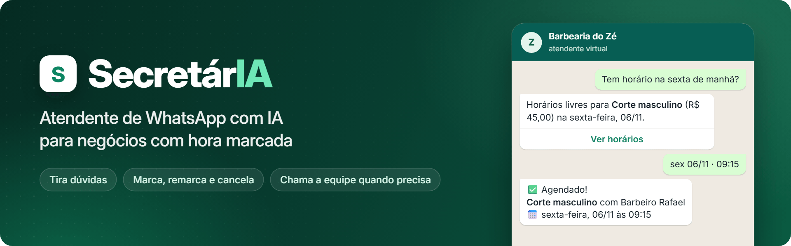
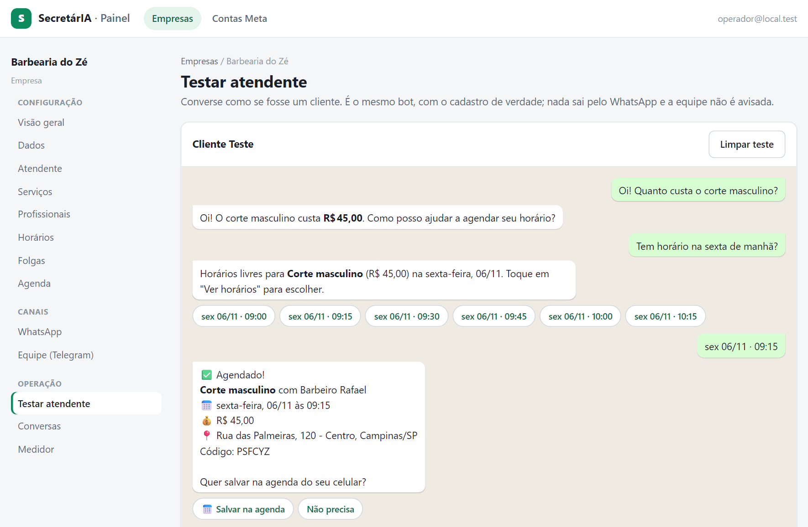
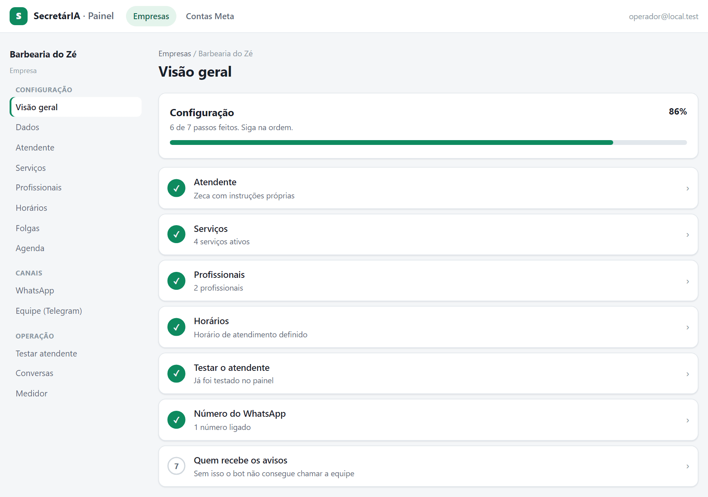
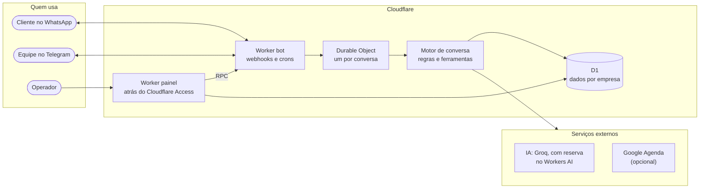

<p align="center">
  
</p>

<p align="center">
  
  
  
  
  <a href="LICENSE.md"></a>
</p>

<p align="center">
  <a href="#funcionalidades">Funcionalidades</a> ·
  <a href="#decisões-técnicas">Decisões técnicas</a> ·
  <a href="#arquitetura">Arquitetura</a> ·
  <a href="#como-rodar">Como rodar</a> ·
  <a href="#testes-e-qualidade">Testes e qualidade</a>
</p>

**SecretárIA** é uma atendente virtual para o WhatsApp oficial de negócios com hora marcada, como barbearias, clínicas, pet shops e estúdios. Ela tira dúvidas só com o que a empresa cadastrou, mostra horários livres, marca, remarca e cancela, e passa a conversa para uma pessoa quando precisa.

Uma única instalação atende várias empresas, com os dados isolados entre elas. O que muda de um negócio para outro é cadastro, não código.

## Em ação

<picture>
  <source media="(prefers-color-scheme: dark)" srcset="docs/assets/painel-chat-escuro.png">
  
</picture>

<p align="center"><sub>Conversa real com a IA no chat de teste do painel, com uma empresa fictícia.</sub></p>

<details>
<summary>Cadastro guiado de cada empresa</summary>
<br>
<picture>
  <source media="(prefers-color-scheme: dark)" srcset="docs/assets/painel-visao-geral-escuro.png">
  
</picture>
</details>

## Funcionalidades

| Recurso | O que faz |
|:---|:---|
| **Atendimento por IA** | Responde em uma mensagem curta, só com os dados da empresa e no vocabulário dela ("consulta", "horário"). Recusa assuntos fora do negócio. |
| **Agenda própria** | Calcula horários livres no fuso da empresa, com profissionais, folgas e intervalo entre serviços. O cliente toca numa lista do WhatsApp para marcar. |
| **Google Agenda** | Opcional: cada marcação vira evento na agenda da empresa, e o que for bloqueado lá some dos horários livres. |
| **Agenda do cliente** | Link "Salvar na agenda": Google Agenda no Android e `.ics` com alarmes no iPhone. |
| **Passagem para humano** | Avisa a equipe no Telegram, que responde pelo mesmo número do WhatsApp e devolve a conversa ao bot com um botão. |
| **Áudio** | Transcreve mensagens de voz de até 2 minutos e as trata como texto. |
| **Lembretes** | Opcional, por empresa: lembrete um dia antes, com os botões Confirmar, Remarcar e Cancelar. |
| **Segmento saúde** | Regras extras: sem orientação clínica, e o agendamento guarda só o serviço, nunca o motivo. |
| **Painel do operador** | Cadastro guiado, chat de teste com a IA real, conversas, medidor de uso e exclusão de dados (LGPD). |

## Decisões técnicas

| Risco | Como foi resolvido |
|:---|:---|
| IA inventar preço ou horário | A IA só escolhe a ferramenta e passa os argumentos. Preço e disponibilidade vêm do banco, e todo texto de agenda é montado pelo servidor. |
| Dois clientes no mesmo horário | Inserção condicional numa única instrução SQL: só um consegue. Remarcar é uma transação. |
| Reentrega de webhook e rajada de mensagens | Um Durable Object por conversa processa um turno por vez, descarta o que já recebeu e agrupa mensagens seguidas numa resposta só. |
| Vazamento entre empresas | Repositório com escopo por empresa e um teste que percorre o SQL e reprova consulta sem `tenant_id`. |
| Cliente tentando manipular o bot | O texto do cliente vai só no papel `user`, e toda ação passa por uma ferramenta validada no servidor. |
| Provedor de IA fora do ar ou sem cota | Cadeia de reserva entre modelos e provedores. Se tudo falhar, avisa a equipe, e só diz ao cliente que avisou se o aviso saiu. |
| Segredos expostos no painel | O painel não guarda nenhum segredo de integração: o que precisa deles passa por RPC até o bot, sem endereço público. |

## Arquitetura



O webhook precisa ser público e o painel, fechado: por isso são dois Workers. O motor de conversa não importa nada da Cloudflare e só conhece interfaces, o que permite testá-lo em Node puro e usá-lo no simulador de terminal. Os detalhes estão em [`docs/ARQUITETURA.md`](docs/ARQUITETURA.md).

### Estrutura do código

```
src/core/      motor de conversa, agenda e regras (sem dependência da Cloudflare)
src/ports/     interfaces: repositório, IA, WhatsApp, notificações, agenda
src/adapters/  implementações: D1, Groq, Workers AI, Meta, Telegram, Google
src/bot/       Worker público: webhooks, Durable Objects, crons e RPC do painel
src/admin/     Worker do painel
migrations/    SQL do D1, numerado
evals/         conversas de avaliação da IA
scripts/       simulador, segredos, deploy e integrações
```

### Tecnologias

| Parte | Tecnologia |
|:---|:---|
| Código | TypeScript estrito, [Hono](https://hono.dev) (JSX no servidor) e htmx |
| Execução | Cloudflare Workers, Durable Objects (SQLite), Cron Triggers e D1 |
| IA | Groq (`gpt-oss-120b` e `gpt-oss-20b`) com reserva no Workers AI |
| Voz | Whisper (Groq e Workers AI) |
| Canais | WhatsApp Cloud API (Meta) e Telegram Bot API |
| Agenda | Google Calendar API, com conta de serviço |
| Acesso ao painel | Cloudflare Access |
| Testes | Vitest com D1 em memória e evals contra a IA real |

## Como rodar

Requer Node 22 ou mais novo. Os comandos abaixo não pedem conta em nenhum serviço. Clone o repositório e, na pasta dele:

```bash
npm install
cp .dev.vars.example .dev.vars
npm run secrets -- gerar                           # cria as chaves locais
npm run db:migrate:local && npm run db:seed:local  # banco local com duas empresas fictícias

npm test                                           # testes
npm run typecheck
npm run sim -- --fake                              # conversa no terminal, com IA falsa e sem agenda
npm run dev:admin                                  # painel e bot em http://127.0.0.1:8787, com login simulado
```

Para conversar com a IA real no chat de teste do painel, como na imagem acima, preencha `GROQ_API_KEY` e `PUBLIC_BASE_URL=http://127.0.0.1:8787` no `.dev.vars` antes de subir o `dev:admin`.

Para publicar e ligar WhatsApp, Telegram, Google Agenda e Cloudflare Access, siga [`docs/OPERACAO.md`](docs/OPERACAO.md).

## Testes e qualidade

Mais de 460 testes automatizados cobrem motor, agenda, webhooks, painel e isolamento entre empresas. Além deles, 12 conversas de avaliação rodam contra a IA real (`npm run evals`) com regras determinísticas: pergunta fora do escopo, preço não cadastrado, tentativa de manipulação, pergunta clínica e marcação completa, entre outras.

As verificações automáticas não usam segredos do projeto nem fazem deploy:

| Quando | O que confere |
|:---|:---|
| A cada commit | `npm run check:public`: tokens, arquivos de segredo, IDs da conta e valores do `.dev.vars` |
| Push e pull request ([ci.yml](.github/workflows/ci.yml)) | Testes em Node 22 e 24, typecheck, build dos dois Workers, vulnerabilidades em dependências de produção e segredos no histórico (gitleaks) |
| Pull request | Vulnerabilidades e licenças de dependências novas |
| Push, pull request e toda semana ([codeql.yml](.github/workflows/codeql.yml)) | Análise de segurança do código (CodeQL) |
| Toda semana ([dependabot.yml](.github/dependabot.yml)) | Atualização de dependências e ações |

## Segurança e privacidade

- Webhooks só são aceitos com assinatura válida (Meta) ou cabeçalho secreto (Telegram).
- O painel fica atrás do Cloudflare Access, com o token validado no código, lista de e-mails e proteção contra CSRF.
- O token da Meta e os chats do Telegram ficam cifrados no banco (AES-256-GCM).
- Os logs não têm telefone, nome nem texto de mensagem.
- As mensagens são apagadas após 7 dias, por padrão, e os dados de um contato podem ser excluídos pelo painel.
- Nenhum segredo ou dado real entra no repositório: há checagem a cada commit.

Achou uma falha? Veja [`SECURITY.md`](SECURITY.md).

## Documentação

- [`docs/ARQUITETURA.md`](docs/ARQUITETURA.md): como o sistema funciona, segurança, LGPD e integrações
- [`docs/OPERACAO.md`](docs/OPERACAO.md): publicação, integrações, pendências e próximos passos

## Licença

[FSL-1.1-MIT](LICENSE.md) (Functional Source License). Em resumo: você pode ler, estudar, modificar e usar o código, inclusive dentro da sua empresa, mas não pode oferecê-lo como produto ou serviço concorrente. Cada versão passa a valer como MIT dois anos depois de publicada. Este resumo não substitui o texto da licença.

As licenças de terceiros estão em [`THIRD_PARTY_NOTICES.md`](THIRD_PARTY_NOTICES.md).
